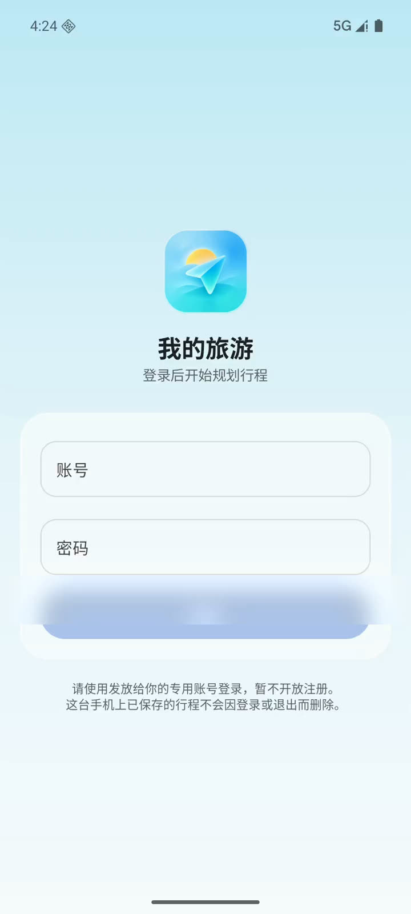
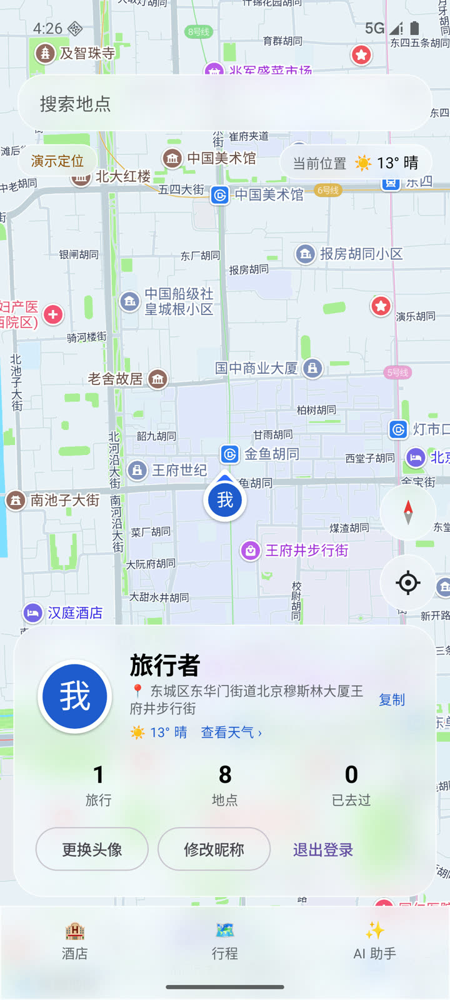
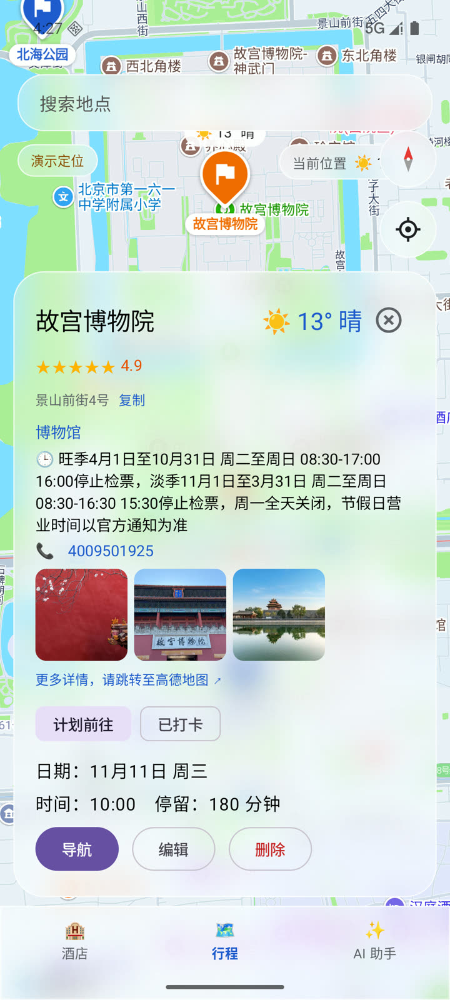
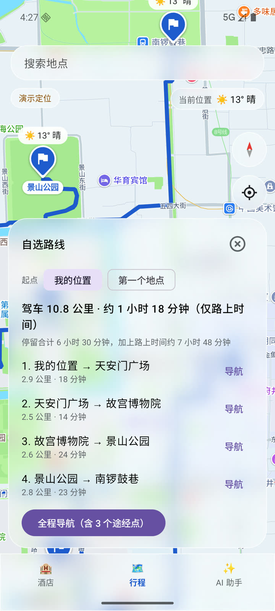
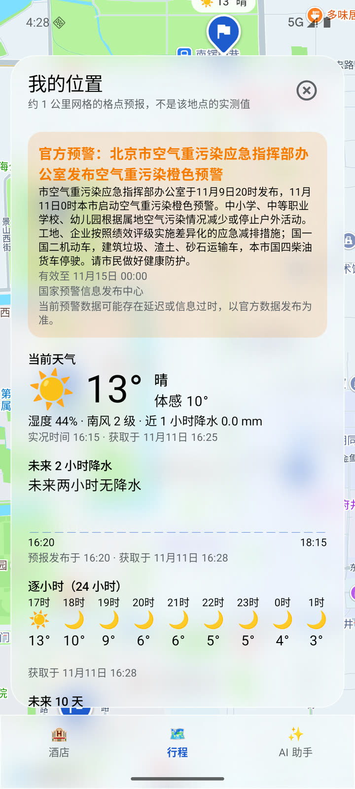
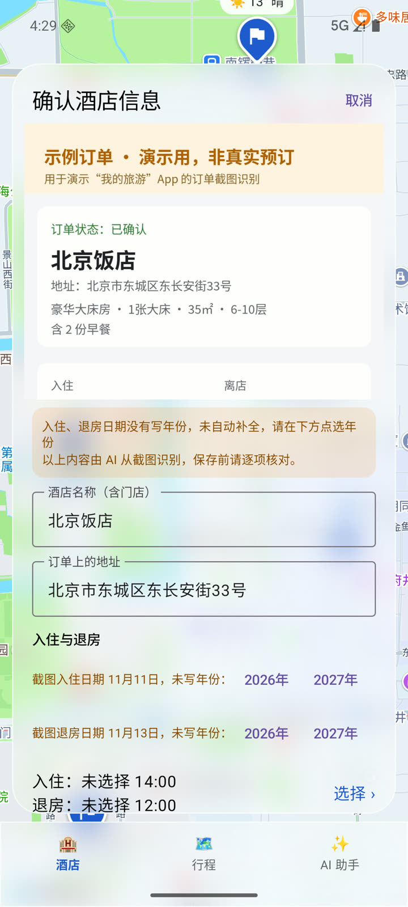
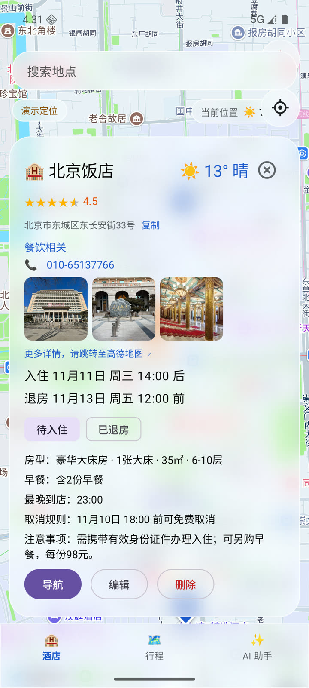
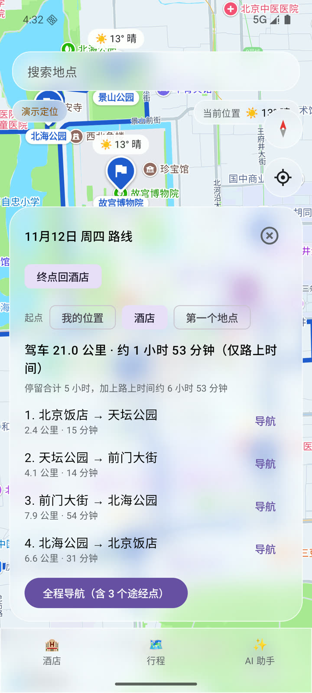
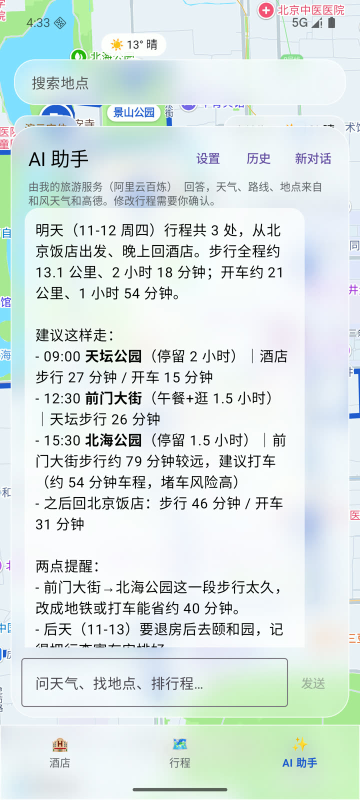

# 我的旅游

以地图为中心、AI 贯穿使用流程的个人旅行 Android App，附带一个最小服务端。打开 App 就是地图：在地图上排行程、看天气、预览真实路线、跳转高德导航；也可以直接对 AI 说“规划一下明天的路线”“酒店那边明天下雨吗”，由 AI 调用 App 自己的功能来完成。

这是一个个人项目，作者本人日常使用，代码公开用于展示。

> 隐私说明：真机截图、验证日志、私人行程与酒店订单、服务器地址和全部凭证都不在本仓库里，详见文末“这个仓库里没有什么”。

## 解决的问题

自由行时，信息散在多个 App 里：地图在高德，天气在天气 App，酒店订单在 OTA 的截图里，攻略在网页上，“今天先去哪、路上多久、下不下雨”需要自己来回切换拼起来。这个 App 把它们收拢到一张地图上：

- **流程 A：从地图开始排行程**。创建旅行，在地图上搜索或长按添加地点，安排日期、时间和顺序；地图上每个地点直接显示当天天气；用高德真实道路规划预览全天路线和每段用时，再一键交给高德地图导航。
- **流程 B：从订单截图开始**。选一张酒店订单截图，由视觉模型解析出酒店名、入住和退房日期等，用户逐项确认后保存；酒店出现在地图和日期里，可以作为路线的起点或终点（“终点回酒店”）。
- **AI 助手**：自然语言查询和操作行程。查询类直接执行，修改类先给出预览、用户确认后才写入；用户手动定的顺序是当前计划，AI 只能建议。

## 截图与演示

以下画面均为**演示数据**：Android 模拟器、演示定位（固定在北京王府井，界面左上角标有“演示定位”）、自动生成的“北京三日游（示例）”、一张标明“示例订单 · 演示用，非真实预订”的订单图，以及本机服务端上的演示账号。地点、照片、评分、路线、天气和 AI 回答都是真实服务返回的结果。

| 登录 | 首页：个人卡片 | 地点卡片 |
| :---: | :---: | :---: |
|  |  |  |
| **路线预览** | **天气详情（含官方预警）** | **订单截图识别：核对确认** |
|  |  |  |
| **酒店卡片** | **AI：打开明天的路线** | **AI：安排建议** |
|  |  |  |


## 架构

```
手机 App（Kotlin + Jetpack Compose）
  ├─ 高德 Android SDK：地图、定位、POI 搜索、路线规划 2.0（手机直连高德）
  ├─ Room：旅行、地点、酒店、AI 对话，全部只存本机，不做云同步
  └─ HTTPS + 会话令牌 ──> 本项目服务端（Python / FastAPI，SQLite）
                              ├─ 阿里云百炼：AI 对话（工具调用）、订单截图解析
                              ├─ DeepSeek Search API：AI 联网搜索
                              └─ 和风天气：服务端用 Ed25519 私钥签 JWT 代请求，并做缓存
```

- 长期密钥（百炼、DeepSeek、和风签名私钥）只放在服务端；手机只持有会话令牌。服务端只提供本 App 需要的几个业务接口，不做通用转发，模型名、上游地址、工具定义和输出上限都由服务端固定。
- release 包在服务端不可用时不会回退到内置密钥，只提示无法连接。

## 技术要点

**App 端**

- **玻璃界面**：`TextureMapView` + [Haze](https://github.com/chrisbanes/haze) 对真实地图做背景模糊（`SurfaceView` 无法被捕获），所有面板统一 28dp 圆角、白色描边的磨砂卡片；玻璃面板吃掉自身的触摸，避免长按穿透到地图误加图钉。
- **路线**：每段都用高德路线规划 2.0 的真实道路结果，从不退化为直线；多点路线按高德一次最多 16 个途经点分段导航。路段结果与“站点坐标 + 出行方式”绑定，站点变化时旧结果不会错位显示；所有路线请求经同一个互斥锁逐个发出，超出高德每秒请求数时只重试一次。
- **AI 工具调用**：十余个工具（查行程、搜地点、地点详情、增删改与排序地点、天气、规划并显示路线、附近景点、按名称定位、联网搜索等）。模型只拿到地点和链接的编号而不是原始网址，回答里的链接由 App 还原，避免模型抄错长网址；参数类型错误会作为错误回给模型，而不是让 App 崩溃。
- **按名称定位**：不取高德的第一个结果，而是按“完全同名 → 以其结尾 → 包含 → 被包含”排序，名称都对不上时宁可不用。
- **天气**：地图标记、地点卡片和天气详情页共用一个 30 分钟本地缓存；AI 回答用到天气时在回答下方标注 QWeather 来源。
- **状态恢复**：路线、导航中的路段、首次定位等可保存状态在跳转高德后被系统回收时也能恢复（已用“杀进程后从任务恢复”在真机上验证）。

**服务端**（`server/`，约 1400 行含测试）

- 账号由本人用命令行创建，不开放注册；密码用 Argon2 哈希，会话令牌只存 SHA-256；错误密码按账号和 IP 限流。
- 统一限额：每天对话轮数、每轮模型调用次数、输入 Token、联网搜索、订单解析、天气上游请求、高德工具调用，以及每月费用上限；本人账号单独保留额度，不受其他账号用量影响。超限直接拒绝并提示，不自动重试。
- AI 回合以 `turn_id` 关联，联网搜索只有在本回合模型确实请求了该工具时才执行，防止客户端伪造搜索请求消耗费用。
- 32 项 pytest 用例，上游全部用假实现，不产生费用。

**工程方法**

本项目全程与 AI 编码助手协作开发，用一套明确的规则约束过程：

- 每条结论标注来源：【我的决定】【官方文档】（附链接和查阅日期）【实测】（指向验证记录）【助手建议】【待核实】；依赖版本、接口参数、配额和价格不凭记忆写。
- 实现状态分“计划实现 / 已经实现 / 已经测试”三档，验证环境区分真实服务、演示数据、模拟器、真机，不把预期写成结论。
- 每轮工作结束记录改了什么、依据、还缺什么、下一步；发布前做差异审查，并用 MobSF 扫描 release 包。

## 目录

```
app/                    Android App（Kotlin + Compose）
server/                 服务端（FastAPI）、测试、systemd 模板、自签证书脚本
```

## 自己构建

需要 Android SDK（compileSdk 37.2）、JDK 25、arm64 真机（高德 SDK 只提供 ARM 库）、以及你自己的各家服务凭证。

1. 在仓库根目录建 `local.properties`（已被忽略），填入 `sdk.dir`、`AMAP_KEY`（高德 Android Key，需绑定你自己的包名和签名 SHA1），以及 `MYTRAVEL_SERVER_URL` / `MYTRAVEL_RELEASE_SERVER_URL`（你的服务端地址）。
2. 服务端：按 `server/README.md` 建虚拟环境、配置上游凭证、用 `make_cert.sh` 生成自签证书、用管理命令创建账号。
3. 如果服务端不在本机回环地址上，把它的地址加到 `app/local-res/xml/network_security_config.xml`（已被忽略，格式同 `app/src/main/res/xml/` 下的同名文件），App 只对这些地址信任这张自签证书。
4. `./gradlew :app:assembleDebug`。

## 这个仓库里没有什么

- 任何凭证：高德 Key、百炼和 DeepSeek Key、和风凭证与签名私钥、签名密钥、服务端证书私钥。
- 服务器的真实地址、账号名、数据库与用量记录。
- 真机截图与录像、运行日志、私人行程与酒店订单样例（`docs/demo/` 里的素材都是在模拟器上用演示数据录的）。
- 开发过程中的需求与设计文档、服务调研、验证记录和工作文档。
- 开发过程中的完整 Git 历史与进度归档；公开仓库从一次干净的初始提交开始。

## 许可

本项目代码以 [GPL-3.0](LICENSE) 发布。

第三方组件按各自条款使用：高德地图 SDK 为高德开放平台专有 SDK，使用需遵守其服务条款并申请自己的 Key；地点图标来自 Material Icons（Apache-2.0）；天气数据来自和风天气（QWeather）。
